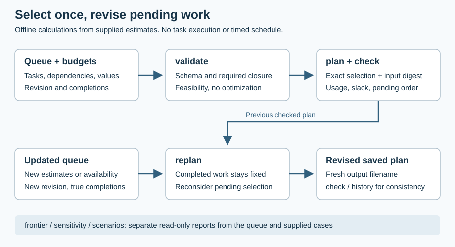

# Reasoning Under Change

**Choose the work that fits. When the estimates change, revise the plan and preserve the history.**

A local developer tool for small queues whose tasks share prerequisites and compete for several budgets. It selects an exact indivisible subset, preserves completed work across revisions, and explains what an alternative selection would displace.

Python 3.11–3.13 · Standard library only · No account, model or task execution · Stable V1 `ruc-work` interface



This is **bounded discrete planning**, not general AI reasoning. Assigned values are your additive priority estimates, not observed business benefits. There are no people, start times, deadlines or concurrent schedules in the model. The earlier changing-environment research remains a separate, explicitly negative diagnostic.

| Question | Command |
| --- | --- |
| Do required tasks and prerequisites fit? | `validate` |
| What exact selection fits these budgets? | `plan`, then `check` |
| What should change after new estimates? | `replan`, then `history` |
| What does forcing this task displace? | `counterfactual` |
| Can a different algorithm find a better selection? | [Selection audit](#ask-a-second-algorithm-to-challenge-the-answer) |

## First selection

From a source checkout or extracted sdist on macOS/Linux, with [uv](https://docs.astral.sh/uv/):

```sh
uv venv .venv
uv pip install --python .venv/bin/python .
.venv/bin/ruc-work --version
.venv/bin/ruc-work validate examples/work_resources.json
.venv/bin/ruc-work plan examples/work_resources.json --out engineering-plan.json
.venv/bin/ruc-work check examples/work_resources.json engineering-plan.json
```

Version prints `1.1.1`. Preflight reports `FEASIBLE`: the schema and required work fit, without optimizing the optional selection. `plan` writes a new file and prints the same JSON, including:

```json
{
  "schema": "ruc-work-plan-v3",
  "selected_ids": ["baseline", "reliability", "telemetry"],
  "total_value": 19,
  "capacity_used": 6,
  "resources_used": {"engineering": 5, "review": 3},
  "resource_slack": {"engineering": 0, "review": 0}
}
```

The full record includes normalized input, its digest, completed/pending IDs and prerequisite-first `pending_order`. `check` reports `VALID`, revision `engineering-1` and value `19`. These are authored coordination slots and engineering/review half-days, not measured durations or benefits.

## Change the budget without rewriting history

The next example records `baseline` complete and reduces the engineering limit from five to four:

```sh
.venv/bin/ruc-work validate examples/work_resources_changed.json
.venv/bin/ruc-work replan examples/work_resources_changed.json engineering-plan.json --out engineering-revised.json
.venv/bin/ruc-work check examples/work_resources_changed.json engineering-revised.json
.venv/bin/ruc-work history engineering-plan.json engineering-revised.json
```

The revised selection retains `baseline` and `reliability`, worth 11 assigned points; pending `telemetry` is dropped. Completed usage counts against every budget once. History checks the supplied revision chain, not its authenticity or whether work actually happened.

For your queue, edit `revision`, `capacity`, `tasks`, `completed_ids` and optional `resource_limits`. Declare one accounting window and unit per budget. Shared prerequisites count once. Completed tasks must include their prerequisites; new completions must come from the prior checked selection. Keep completed definitions unchanged and change revision when estimates change. [Authoring and preflight](docs/USAGE.md#input-preflight).

## Inspect the tradeoff

```sh
.venv/bin/ruc-work counterfactual examples/work_resources.json search
.venv/bin/ruc-work sensitivity examples/work_resources.json --capacities 0 4 6 8
.venv/bin/ruc-work frontier examples/work_resources.json
.venv/bin/ruc-work scenarios examples/work_prerequisites_changed.json examples/work_scenarios.json --out scenario-report.json
```

Counterfactuals include infeasible forced closures. Sensitivity preserves requested capacity order. The frontier varies main capacity with named limits fixed. Scenarios minimize maximum regret over supplied cases with comparable additive values and no probability assumptions. Reports cannot replace saved plans in `check`, `replan` or `history`.

## Ask a second algorithm to challenge the answer

The selection auditor does not call the optimizer, its selection routine or `work.check`. It enumerates bounded subsets and rechecks constraints using separate logic. Version 1.1.1 maintains subset totals incrementally while preserving numeric mask order and the first better-selection witness:

```sh
.venv/bin/python -m reasoning_under_change.audit --input examples/work_resources.json --plan engineering-plan.json
```

| Audit result | Meaning |
| --- | --- |
| `OPTIMAL_FOR_INPUT` | Complete enumeration found no better feasible value |
| `SUBOPTIMAL` | A concrete better selection is returned for inspection |
| `INFEASIBLE_SELECTION` | Required work, prerequisites or budgets are violated |
| `FEASIBLE_UNPROVEN` | The node/time budget ended; optimality is not established |

Exit 0 requires `OPTIMAL_FOR_INPUT`; other completed verdicts return 1, and invalid input returns 2. The default budget is 65,536 subsets and one second. Larger accepted inputs need not exhaust. A tied alternative optimal selection is valid: the audit does not impose the optimizer's tie-break.

This checks **input digest, selected IDs and total value**, not every plan metadata field. Continue using `check` for the stable full-artifact contract. Input normalization is shared, so this is algorithmic diversity, not independent organizational verification, a formal proof of the implementation or validation of your business values. [Tests and seeded small-instance comparisons](tests/test_independent_audit.py).

## Limits and simpler alternatives

Inputs admit at most 20 tasks, four named integer budgets, main capacity 0..128 and integer demand 1..128. Prerequisites form a DAG; mandatory work forces its closure. Exact planning shares a cooperative one-second deadline and node ceilings across each command. A timeout returns no partial exact recommendation. [All limits](docs/LIMITATIONS.md).

A spreadsheet or prerequisite-aware greedy pass is often enough when you only need a good feasible queue. A short exhaustive script is reasonable for very small queues. This package adds deterministic selection, revision checks and inspectable reports; it makes no speed or human-time-saving claim.

| Claim to scrutinize | Test or boundary |
| --- | --- |
| “This selection is optimal” | Independent exhaustive comparison; a budget stop remains unproven |
| “This revision preserves history” | Completed definitions and prerequisites remain fixed and accounted once |
| “The output is safe to retry” | Exclusive staged publication refuses existing files; inspect the destination after an output error |
| “The adaptive AI works better” | Not established: the retained reactive baseline wins the authored changing-environment comparison |

## Help and recovery

Start with `ruc-work --help`, `plan --help` or `python -m reasoning_under_change.audit --help`.

| Symptom | Recovery |
| --- | --- |
| `INVALID_INPUT`, exit 2 | Correct schema, duplicate keys or arguments; preflight again |
| `INFEASIBLE` preflight, exit 0 | Calculation completed but required demand does not fit; no selection is recommended |
| Stale saved plan | Restore its exact input for inspection or use a new revision and `replan` |
| Completed work exceeds a budget | Correct accounting or start a new accounting window; never erase completion silently |
| Destination exists | Inspect it or choose another filename; symlinks and existing files are not replaced |
| `OUTPUT_ERROR`, exit 1 | Inspect the requested output before retrying; stdout or staging cleanup may have failed after saving |
| Timeout/node ceiling | Reduce the queue or cases; no partial exact result is returned |
| Audit `FEASIBLE_UNPROVEN`, exit 1 | Inspect `stop_reason`; raise `--node-limit` (at most 1,048,576) and `--timeout-seconds` (at most 30), or retain the unproven verdict |

Outputs are staged beside their destination and published without replacement only after complete write and close. This is not power-loss durability or protection against a hostile local filesystem. [I/O contract](docs/USAGE.md#results-and-errors).

## Python API

```python
import json
from reasoning_under_change.work import validate, plan, check

with open("examples/work_resources.json", encoding="utf-8") as source:
    queue = json.load(source)
assert validate(queue)["status"] == "FEASIBLE"
saved = plan(queue)
assert check(queue, saved)["status"] == "VALID"
```

Supported APIs return JSON-compatible dictionaries and raise `ScenarioError` for invalid bounded inputs or incomplete exact calculations. [Stable API and artifact inventory](docs/STABILITY.md). The selection audit added in 1.1 has its own documented report and exit-code contract.

## Retained research diagnostics

`ruc-scenario --example`, `ruc-grid`, `ruc-planning --v2` and `ruc-results` remain available. Bundled records are hash-checked. Reactive completes 59/64 accepted actions versus 43/64 for the adaptive heuristic in the authored changing simulation. In exposed static planning, exact DP and full search tie in quality; a retained latency difference is not a general speed result. No live-model improvement, human utility, production trial or cited-paper reproduction follows. [Protocols and full tables](docs/EVALUATION.md).

## Development and project information

```sh
PYTHONPATH=src uv run --no-project python -m unittest discover -s tests -v
uvx --from ruff==0.17.1 ruff check --no-cache src tests scripts
uv run --no-project python scripts/verify_release.py
```

The release gate builds and installs an sdist-derived wheel outside source, exercises installed tests and advertised commands, and validates packaged docs and the README journey. Logs/hashes stay under `.release-scratch/`; `RUC_RELEASE_SCRATCH` selects another owned directory. Hosted results must be inspected for the exact revision.

[Validation](docs/VALIDATION.md) · [Usage](docs/USAGE.md) · [Design](docs/DESIGN.md) · [Stability](docs/STABILITY.md) · [Limitations](docs/LIMITATIONS.md) · [References](docs/REFERENCES.md) · [Support](SUPPORT.md) · [Security](SECURITY.md) · [Contributing](CONTRIBUTING.md) · [Releasing](docs/RELEASING.md) · [Changelog](CHANGELOG.md) · [MIT licence](LICENSE)

Personal R&D by Jason Lovell, independent of employers and clients. No affiliation, endorsement or confidential information use is claimed.
